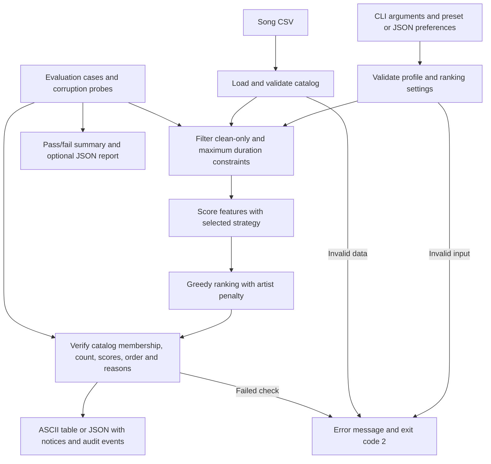

# VibeFinder: Music Recommender Simulation

A working CLI-first, content-based recommender for **Project 3**, extended with an integrated **Project 4 reliability workflow**. It ranks 24 fictional songs, explains every score, supports five listener profiles and three ranking modes, and can reduce repeated-artist exposure. It runs locally without API keys or a network connection. This is a transparent rules-based AI simulation, not a trained model or an LLM.

## How The System Works

Real recommenders distinguish **input data** (song metadata and behavior such as listening history, likes, and skips) from **user preferences** inferred from that behavior. Spotify describes using listening interactions and content characteristics such as genre and release date in its [recommendation overview](https://www.spotify.com/uk/safetyandprivacy/understanding-recommendations). **Collaborative filtering** learns from patterns across listeners and items; **content-based filtering** compares item features against a listener's interests. Google's [candidate generation guide](https://developers.google.com/machine-learning/recommendation/overview/candidate-generation) explains these approaches. **Ranking and selection** then order candidates and choose a short list: YouTube's [2016 research paper](https://research.google/pubs/deep-neural-networks-for-youtube-recommendations/) describes separate candidate-generation and ranking models. That historical paper is an illustration, not a claim about YouTube's exact current implementation.

VibeFinder uses explicit preferences instead of learned listening history. Genre and mood are categorical matches; energy, tempo, and optional attributes measure closeness to a target. Mood and audio descriptors here are synthetic annotations, not features extracted from audio. Scoring judges one song; ranking compares the catalog and selects the best candidates. There is no collaborative filtering because this dataset contains no listener interactions.

### Data and profiles

`data/songs.csv` preserves the starter's 10 tracks and adds 14 fictional tracks. Every row contains `id`, `title`, `artist`, `genre`, `mood`, `energy`, `tempo_bpm`, `valence`, `danceability`, and `acousticness`, plus six new fields: `instrumentalness`, `popularity`, `release_year`, `duration_seconds`, `language`, and `explicit`. All metadata, popularity values, and content labels are simulated. The catalog spans 14 genre labels; it does not represent actual streaming data.

Dictionary profiles require `genre`, `mood`, and `energy`. Other numeric features and `language` are optional target preferences. Only supplied preferences contribute to a score. `src/profiles.py` defines pop, lofi, rock, EDM, and acoustic listeners. The acoustic profile uses all five new scored attributes; `explicit` is used as a hard eligibility filter. The starter's `Song`, `UserProfile`, and `Recommender` object interfaces delegate to the same scoring logic. `likes_acoustic` maps to acousticness 1.0 or 0.0.

### Algorithm recipe

For numerical feature `f`, the contribution is:

```text
weight[f] * max(0, 1 - abs(song[f] - target[f]) / distance_scale[f])
base score = sum of contributions from the supplied preferences
selection score = base score - artist_penalty * already_selected_tracks_by_artist
```

| Mode | Genre match | Mood match | Energy weight |
| --- | ---: | ---: | ---: |
| genre-first | 2.0 | 1.0 | 1.0 |
| mood-first | 0.5 | 3.0 | 1.0 |
| energy-first | 1.0 | 1.0 | 2.0 |

Tempo has weight 1.0; every other optional preference has weight 0.5. A categorical mismatch contributes zero. Energy and other 0–1 features use distance scale 1; tempo uses 100 BPM; popularity uses 100; release year uses 50 years; duration uses 300 seconds. For example, Sunrise City scores `2 + 1 + (1 - abs(0.82 - 0.8)) = 3.98` for the basic pop profile before diversity adjustment. A low-energy preference rewards low energy, not simply a higher feature value.

The ranker repeatedly selects the highest current selection score, breaking ties by smaller song ID. The CLI defaults to a 0.75 penalty for each prior selection from the same artist. `--artist-penalty 0` produces ordinary descending base-score ranking. Returned scores reflect penalties at selection time and remain descending because penalties only increase. Reasons show each contribution and any penalty; displayed decimals are rounded, but ranking uses full precision. Scores are **not probabilities** and should not be compared across profiles with different features or modes.

The `RankingStrategy` data objects implement the Strategy pattern: mode selection supplies interchangeable weights to one scoring engine. Both scoring APIs use it. Ranking creates a new result list and does not mutate the catalog. Python's `sorted()` likewise returns a new list; `.sort()` modifies its list in place. The diversity implementation uses greedy selection because the artist costs change after each pick.

## Setup and run

Use **Python 3.10 or newer**. Run commands inside this repository folder.

1. Create a virtual environment:

   ```bash
   python -m venv .venv
   ```

2. Activate it in PowerShell:

   ```powershell
   .\.venv\Scripts\Activate.ps1
   ```

   Or on macOS/Linux:

   ```bash
   source .venv/bin/activate
   ```

   If local PowerShell policy blocks activation, use `.\.venv\Scripts\python.exe` in place of `python` below; activation is not required.

3. Install test dependencies (the app itself uses only the standard library):

   ```bash
   python -m pip install -r requirements.txt
   ```

4. Run and experiment:

   ```bash
   python -m src.main
   python -m src.main --all-profiles
   python -m src.main --profile pop --mode mood-first --top-k 3
   python -m src.main --profile pop --mode energy-first
   python -m src.main --profile pop --artist-penalty 0
   python -m src.main --profile-file examples/custom_profile.json
   python -m src.main --profile rock --clean-only --max-duration 225
   python -m src.main --profile edm --json
   python -m src.main --help
   ```

5. Run tests and the independent behavioral evaluator:

   ```bash
   python -m pytest -q
   python -m src.evaluate --report docs/evaluation.json
   ```

The catalog defaults to a path resolved from the source file. `--songs path/to/songs.csv` selects a different catalog with the same schema. `--top-k` accepts 1–100; a small catalog returns fewer songs with a notice. Unknown genres are accepted with a notice if absent from eligible songs; misspelled field names are rejected. Numeric ranges are documented in [the model card](model_card.md).

## Sample Recommendation Output

These are captured runs for three distinct profiles, including top-five rankings and the actual scoring reasons. Regenerate this section and the other examples with `python -m src.capture_examples`.

<!-- BEGIN GENERATED SAMPLES -->

```console
$ python -m src.main --profile pop
Profile: pop | mode: genre-first | loaded: 24 | eligible: 24
#   Song / artist                              Score  Reasons
--------------------------------------------------------------------------------------------------------------------
1   Golden Hour / Neon Echo                    4.000  genre match (+2.000); mood match (+1.000); energy 0.8 vs 0.8
                                                      (+1.000)
2   Open Windows / Daylight Club               3.920  genre match (+2.000); mood match (+1.000); energy 0.72 vs
                                                      0.8 (+0.920)
3   Sunrise City / Neon Echo                   3.230  genre match (+2.000); mood match (+1.000); energy 0.82 vs
                                                      0.8 (+0.980); repeat artist penalty (-0.750)
4   Gym Hero / Max Pulse                       2.870  genre match (+2.000); mood mismatch (+0.000); energy 0.93 vs
                                                      0.8 (+0.870)
5   Barrio Sol / Luna Calle                    1.970  genre mismatch (+0.000); mood match (+1.000); energy 0.83 vs
                                                      0.8 (+0.970)
Output checks: passed
```

Exit status: 0.

```console
$ python -m src.main --profile lofi
Profile: lofi | mode: genre-first | loaded: 24 | eligible: 24
#   Song / artist                              Score  Reasons
--------------------------------------------------------------------------------------------------------------------
1   Quiet Pages / Paper Lanterns               5.475  genre match (+2.000); mood match (+1.000); energy 0.29 vs
                                                      0.3 (+0.990); tempo_bpm 74 vs 75 (+0.990); acousticness 0.91
                                                      vs 0.9 (+0.495)
2   Midnight Coding / LoRoom                   5.255  genre match (+2.000); mood match (+1.000); energy 0.42 vs
                                                      0.3 (+0.880); tempo_bpm 78 vs 75 (+0.970); acousticness 0.71
                                                      vs 0.9 (+0.405)
3   Library Rain / Paper Lanterns              4.650  genre match (+2.000); mood match (+1.000); energy 0.35 vs
                                                      0.3 (+0.950); tempo_bpm 72 vs 75 (+0.970); acousticness 0.86
                                                      vs 0.9 (+0.480); repeat artist penalty (-0.750)
4   Focus Flow / LoRoom                        3.540  genre match (+2.000); mood mismatch (+0.000); energy 0.4 vs
                                                      0.3 (+0.900); tempo_bpm 80 vs 75 (+0.950); acousticness 0.78
                                                      vs 0.9 (+0.440); repeat artist penalty (-0.750)
5   Spacewalk Thoughts / Orbit Bloom           3.320  genre mismatch (+0.000); mood match (+1.000); energy 0.28 vs
                                                      0.3 (+0.980); tempo_bpm 60 vs 75 (+0.850); acousticness 0.92
                                                      vs 0.9 (+0.490)
Output checks: passed
```

Exit status: 0.

```console
$ python -m src.main --profile rock
Profile: rock | mode: genre-first | loaded: 24 | eligible: 24
#   Song / artist                              Score  Reasons
--------------------------------------------------------------------------------------------------------------------
1   Iron Horizon / Voltline                    5.450  genre match (+2.000); mood match (+1.000); energy 0.96 vs
                                                      0.95 (+0.990); tempo_bpm 158 vs 155 (+0.970); acousticness
                                                      0.08 vs 0.1 (+0.490)
2   Wild Current / Granite Sky                 5.320  genre match (+2.000); mood match (+1.000); energy 0.88 vs
                                                      0.95 (+0.930); tempo_bpm 145 vs 155 (+0.900); acousticness
                                                      0.12 vs 0.1 (+0.490)
3   Storm Runner / Voltline                    4.680  genre match (+2.000); mood match (+1.000); energy 0.91 vs
                                                      0.95 (+0.960); tempo_bpm 152 vs 155 (+0.970); acousticness
                                                      0.1 vs 0.1 (+0.500); repeat artist penalty (-0.750)
4   Pulse Circuit / Prism Engine               3.285  genre mismatch (+0.000); mood match (+1.000); energy 0.97 vs
                                                      0.95 (+0.980); tempo_bpm 140 vs 155 (+0.850); acousticness
                                                      0.01 vs 0.1 (+0.455)
5   Gym Hero / Max Pulse                       3.225  genre mismatch (+0.000); mood match (+1.000); energy 0.93 vs
                                                      0.95 (+0.980); tempo_bpm 132 vs 155 (+0.770); acousticness
                                                      0.05 vs 0.1 (+0.475)
Output checks: passed
```

Exit status: 0.

<!-- END GENERATED SAMPLES -->

EDM and acoustic runs, mode comparisons, and guardrail examples are also captured in [docs/examples.md](docs/examples.md). Every profile can be reproduced with `--profile NAME`.

## Experiments and observations

The default pop top two contain two artists; disabling the artist penalty makes both tracks Neon Echo. Artist variety improves at a small cost to base preference score; the penalty does not guarantee distinct artists or demographic fairness.

Switching pop from `genre-first` to `energy-first` halves the genre weight and doubles the energy weight. Golden Hour, Open Windows, and Sunrise City remain first through third; Barrio Sol and Rooftop Lights replace Gym Hero and Barrio Sol at positions four and five. Mood-first instead promotes happy songs across genres. These are changes in preference tradeoffs, not evidence of improved listener satisfaction. See the [model card](model_card.md) for profile comparisons, numerical results, and limitations.

## Project 4: applied reliability extension

**Base project:** Project 3's Music Recommender Simulation ranks a local catalog using explicit preferences and returns score explanations. Its scope is a small deterministic content-based recommender, without learned user history, retrieval, or an LLM.

**New feature:** `src/reliability.py` integrates a validate → constrain → rank → verify workflow into every CLI recommendation. It rejects bad profiles/catalogs, filters explicit content or long tracks before ranking, preserves hard constraints when too few songs qualify, and checks returned track membership, uniqueness, count, score arithmetic, descending order, and explanation consistency before displaying output. Invalid requests exit with code 2 and an actionable message. Failed output checks also stop the CLI. Structured audit events are included in `--json` output. This implements the rubric's reliability-mechanism option; it does not claim RAG, fine-tuning, or an autonomous agent.

For rock, the baseline top track is explicit Iron Horizon. With `--clean-only --max-duration 225`, the top track becomes Wild Current. A one-second duration limit yields no recommendations and a notice instead of silently breaking the constraint. The evaluator deliberately injects an invented explanation and confirms it is rejected. Exact commands and captured output are in [guardrail examples](docs/examples.md#guardrail-demonstrations).

The implementation's data flow is available as [Mermaid source](docs/architecture.mmd):



The harness runs 13 fixed cases and exits nonzero on any failure. [docs/evaluation.json](docs/evaluation.json) records the results. Tests also exercise all profiles and modes, exact arithmetic, extra-feature effects, tie-breaking, malformed CSV, nonfinite numbers, output corruption, and CLI behavior. These checks measure implementation behavior; they do not measure how much a human enjoys a recommendation.

## Reflection and AI collaboration

This project shows how much a few scoring choices can change a recommendation. A song can move up because it matches the listener's mood, or move down because its artist already appeared. Showing the points beside each result makes those choices easier to understand. It also makes the limits clearer: a higher score means a closer match to the chosen rules, not necessarily a better song.

AI helped build the code, expand the fictional catalog, write tests, and document the results. The tests check that the scoring and explanations agree, but listener feedback would still be needed to judge whether the playlists are enjoyable. The longer [reflection in the model card](model_card.md#development-reflection) discusses the experiments and what I would try next. [ai_interactions.md](ai_interactions.md) records the AI assistance and the design choices that were kept or changed.

## Rubric evidence

| Requirement | Where to inspect |
| --- | --- |
| Project 3 explanation, dataset, scoring and sorted recommendations | This README; `data/songs.csv`; `src/recommender.py` |
| Reasons and three profile experiments | Captured text above; `model_card.md` |
| Completed technical model card | `model_card.md` |
| Five additional scored attributes and AI workflow | `src/profiles.py`; `ai_interactions.md` |
| Diversity, switchable strategies, readable table | `src/recommender.py`; `src/main.py` |
| Project 4 base scope and integrated reliability feature | Project 4 section; `src/reliability.py` |
| Architecture, end-to-end examples and guardrails | `docs/architecture.mmd`; `docs/examples.md` |
| Setup, testing, collaboration reflection | This README; `ai_interactions.md` |
| Project 4 evaluation-script stretch | `src/evaluate.py`; `docs/evaluation.json` |

Project 4 RAG, autonomous-agent, and fine-tuning stretch features are outside this implementation. This map identifies evidence, not a guaranteed grade.
